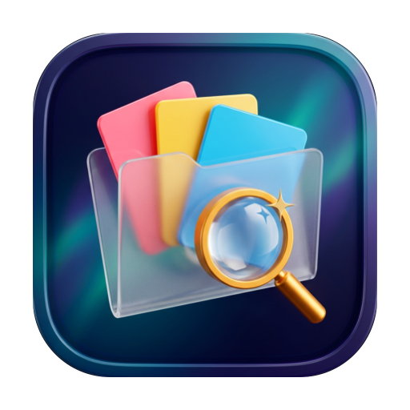

<p align="center">
  
</p>

<h1 align="center">Findy</h1>

<p align="center">
  <strong>A fast, native, 100% local & open-source macOS file companion.</strong><br/>
  Search in plain English, read text inside screenshots with on-device Vision OCR, visualize storage with Space Lens, batch-rename files, and clean up duplicates & clutter.
</p>

<p align="center">
  
  
  
  
</p>

---

## ✨ Features

- **🔎 Natural-Language Search (`⌘F` & `⌥Space`)**
  Type queries the way you think:
  - `"pdfs from last week over 5 mb"`
  - `"screenshots from yesterday"`
  - `"videos from slack in downloads"`
  - `"photos shot on iphone in 2025 tagged red"`
  Findy translates plain-English phrases into structured Spotlight (`NSMetadataQuery`) predicates plus a fast on-disk fallback scanner, displaying **"Understood as"** filter chips in real time.

- **👁️ On-Device OCR Text Search (`Vision` + `PDFKit`)**
  Automatically indexes text inside screenshots, images, and PDFs using Apple's on-device `VNRecognizeTextRequest`. Search for a phrase inside a screenshot or press `⇧⌘C` to copy text directly from any image.

- **📊 Space Lens Storage Analyzer (`⇧⌘L`)**
  Interactive proportional treemap, category breakdown, and **Storage by Home Folder** drill-down across your home folders. Filter by category (`Videos`, `Images`, `Documents`, `Archives`, `Applications`, `Code`, `Music`), click any home folder to jump straight into it, and inspect the largest files on your Mac.

- **📥 File Shelf / Drop Basket (`⇧⌘B` & `⌘7`)**
  Stage files from across multiple folders, categories, or searches into a persistent sidebar drop basket. Once collected, **Move All To…**, **Copy All To…**, **Compress to `.zip` Archive**, or **Batch Rename** the entire shelf in a single action.

- **✏️ Smart Batch Rename Studio (`⇧⌘R`) with Regex & 1-Click Undo (`⌥⌘Z`)**
  Select files and open a live-preview rename studio supporting:
  - Find & Replace + **Regular Expression (`Regex`) capture groups (`$1`, `$2`)**
  - Prefix, Suffix & **Extension override**
  - Sequential numbering (`01, 02, 03…`) with configurable start & padding digits
  - Modification date stamping (`YYYY-MM-DD`)
  - Case transformations (`lowercase`, `UPPERCASE`, `Title Case`, `kebab-case`)
  - Automatic filename conflict detection & **1-Click Undo Last Batch Rename (`⌥⌘Z`)**

- **🗜️ Native `.zip` Archive Creation**
  Right-click any file or multi-selection (or use the Selection Bar / File Shelf) to compress items into a conflict-free `.zip` archive via `/usr/bin/ditto`.

- **🧹 Smart Clean Up & Multi-Stage Duplicate Finder**
  - **Exact Duplicates**: Pre-filters by file size, hashes three `16 KB` windows (`head`, `middle`, `tail`), and verifies exact matches with streaming `SHA-256`. Automatically selects the best original to keep.
  - **Similar Photos**: Uses `VNGenerateImageFeaturePrintRequest` perceptual distance clustering to spot burst shots and near-identical photos on-device.
  - **Clutter Rules**: Surfaces Old Installers (`.dmg`, `.pkg`), Forgotten Downloads, Old Screenshots, Big Old Videos (`> 200 MB`), and Unused Apps, plus optional hourly background auto-cleanup.

- **🌐 "Downloaded From" Provenance (`kMDItemWhereFroms`)**
  Automatically groups downloaded files by over **40+ sources** including Slack, GitHub, Figma, Google Drive, Notion, Linear, ChatGPT, Claude, Discord, WhatsApp, Telegram, Mail, and AirDrop.

- **🏷️ Native Finder Color Tags & Developer Inspector (`⌘I`)**
  Read, assign, and filter by macOS Finder tags (`Red`, `Orange`, `Yellow`, `Green`, `Blue`, `Purple`, `Gray`), inspect UTI identifiers and POSIX octal permissions, compute on-demand **SHA-256 checksums**, or open any file's parent folder in Terminal.

- **🎵 Built-in Audio MiniPlayer & Menu Bar Recent Downloads**
  Play audio tracks directly from the browser with a persistent sidebar `MiniPlayer`, and drag or open your latest downloads from the macOS menu bar.

---

## ⌨️ Keyboard Shortcuts

| Shortcut | Action |
| :--- | :--- |
| `⌥Space` | Toggle Global Quick Search Floating Bar |
| `⌘F` | Focus Main Search Bar |
| `Space` | Quick Look Preview (with Live Text OCR toggle) |
| `⌘I` | Toggle File Details & Checksum Inspector |
| `⇧⌘L` | Open Space Lens Storage Analyzer |
| `⇧⌘B` | Add Selected Files to File Shelf (Drop Basket) |
| `⇧⌘R` | Open Smart Batch Rename Studio |
| `⌥⌘Z` | Undo Last Batch Rename |
| `⇧⌘C` | Copy Recognized Text from Selected Image |
| `⌃⌘T` | Toggle Theme (`Playful` / `Minimal`) |
| `⌘+` / `⌘-` | Increase / Decrease Gallery Card Size |
| `⌘⌫` | Move Selected Files to Trash |
| `⌘1` … `⌘7` | Jump to Home, Recents, Space Lens, Clean Up, Duplicates, Downloaded From, File Shelf |

---

## 🚀 Installation & Building from Source

### Requirements
- **macOS 14.0 (Sonoma)** or later
- **Xcode 15.4+** (or Swift 5.9+ Command Line Tools)

### Option 1: Open in Xcode (`Findy.xcodeproj`) — Run, Test, Sign & Archive

```bash
open Findy.xcodeproj
```

1. **Run & Debug (`⌘R`)**: Select the **Findy** scheme (`My Mac`) and press `⌘R`.
2. **Run Unit Tests (`⌘U`)**: Press `⌘U` to run the `FindyTests` unit test bundle.
3. **Code Signing & Notarization**:
   - Click the **Findy** project in the Project Navigator → select the **Findy** target → open **Signing & Capabilities**.
   - Select your **Team** (`Apple Development` / `Developer ID Application`).
   - Entitlements (`Config/Findy.entitlements`), Hardened Runtime (`ENABLE_HARDENED_RUNTIME = YES`), Info.plist (`Config/Info.plist`), and AppIcon asset catalog (`Assets/Assets.xcassets`) are pre-configured.
   - Choose **Product › Archive** to export a signed/notarized macOS `.app` or `.pkg`.

### Option 2: CLI Build & Install to `/Applications`

```bash
git clone https://github.com/Shubham-sharma8/findy.git
cd Findy

# Build release binary, assemble Findy.app, codesign, and install to /Applications/Findy.app
./build-app.sh --install
```

### Run Unit Tests via CLI

```bash
xcodebuild -project Findy.xcodeproj -scheme Findy test
# or via SwiftPM:
swift test
```

---

## 🔒 Privacy & Security Architecture

- **Zero Telemetry**: Findy makes **no** network requests, contains no analytics SDKs, and requires no account or license key.
- **Trash-Only Deletion**: All cleanup and duplicate-removal operations use `FileManager.default.trashItem(at:resultingItemURL:)` so files can always be restored from the macOS Trash.
- **100% On-Device AI**: OCR (`VNRecognizeTextRequest`) and similar-photo detection (`VNGenerateImageFeaturePrintRequest`) run locally on Apple Silicon / Intel via the macOS Vision framework.

---

## 🤝 Contributing

Contributions, bug reports, and feature requests are welcome! Please read [CONTRIBUTING.md](CONTRIBUTING.md) before submitting a Pull Request.

## 📄 License

Distributed under the **MIT License**. See [LICENSE](LICENSE) for details.
